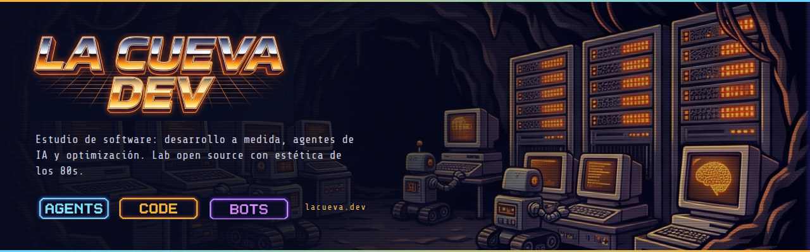
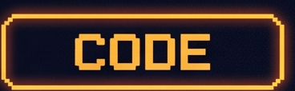
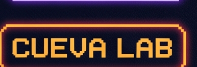

  

  <b>Software a medida, agentes de IA y optimización. Cocinado en la cueva.</b> 
  Estudio de software independiente en Mar del Plata, Argentina. Lo que sobra del lab, lo publicamos acá.

  <a href="https://lacueva.dev">lacueva.dev</a>

---

## Qué hacemos

- **Producto desde cero** — de la idea (o la planilla que ya no da más) a un MVP en producción.
- **Software a medida** — herramientas internas, dashboards, APIs e integraciones.
- **Optimización y evolución** — performance, deuda técnica, migraciones, observabilidad.
- **Agentes y automatización** — bots y agentes con LLMs que terminan tareas de verdad.

## El lab

Herramientas, bots y experimentos que nacen en proyectos reales y se publican para que los use cualquiera.

<!-- TODO: listar los repos destacados cuando existan -->

  
  
  
  

